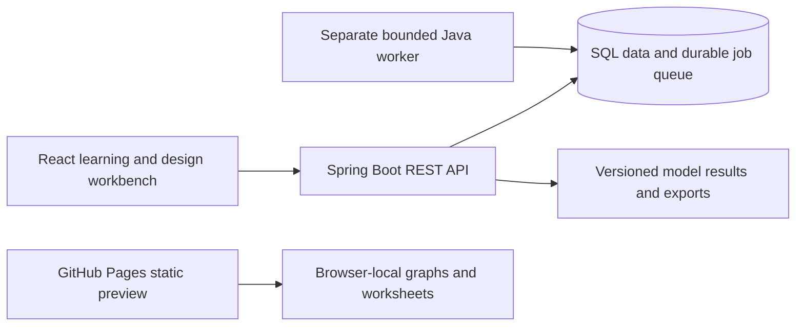

# ArchArena

A system-design learning and practice platform for Java backend developers. Study an idea, draw a request path, predict a bottleneck, and use a bounded Java model to investigate the trade-off.

**Live static preview:** https://yashi2212.github.io/ArchArena/
**Source:** https://github.com/Yashi2212/ArchArena

The GitHub Pages preview provides the learning library, tutorial, local architecture editor, scenario worksheets and Design Studio exports. GitHub Pages cannot host Spring Boot: server-side simulations, checkpoints and server saves run locally for now. The preview clearly labels this and never supplies fabricated run metrics. AWS deployment is deferred.

## What you can explore

- **Learn:** 24 HLD and 16 LLD topics, each with Story/Simple/Pro explanations, an original flow, worked example, trade-off, common mistake and references.
- **Company studies:** twenty original interview reference proposals, including an Uber-inspired ride-hailing study covering location freshness, candidate discovery, exclusive assignment and trip lifecycle. These are not verified company blueprints or endorsements.
- **Practice:** editable graphs and scenario-specific HLD/LLD worksheets, capacity assumptions, predictions and rule-based coaching. Five concept labs cover load balancing, caching, replication, queues and rate limiting.
- **Java engine:** analytic estimates and a seeded discrete-event simulator with nine component types, bounded retries/deadlines, circuit breakers, cascading pressure, delayed scale-out, synthetic replica lag and failure injection.
- **Replay:** sampled node history, bounded request traces, modeled metrics, baseline comparison and Markdown experiment export when the backend is running.
- **Design Studio:** six browser-local artifacts: requirements, capacity, HLD, API, data model and LLD. Capture a detached Practice graph snapshot and export a JSON bundle.
- **Tutorial:** an original 72-second introduction with synthetic narration, captions, chapter controls and transcript.

## Architecture



The API validates graphs and admits bounded jobs. A separate worker claims durable jobs with leases, runs the model and persists results. Idempotent submission and version checks protect repeated requests and stale writes. The browser distinguishes analytic estimates from completed seeded experiments.

| Layer | Current implementation |
|---|---|
| Backend | Java 21, Spring Boot 4.0.9, REST API, separate JVM worker |
| Persistence | JDBC, Flyway and H2 verified locally; PostgreSQL adapter verification remains pending |
| Frontend | React, TypeScript, Vite, React Flow and Recharts |
| Quality | JUnit, Vitest, Testing Library, Playwright, axe and visual baselines |
| Publishing | GitHub Actions builds a static Pages preview; no Java API or credentials in that site |

JPA/Hibernate, managed AWS services and live AI are not implemented merely because they appear in planning documents. Current coaching is deterministic and supplied prose still needs human review.

## Run the complete project locally

Prerequisites: Node.js 24 and Java 21. On Windows, from the repository root:

```powershell
npm.cmd --prefix frontend ci --legacy-peer-deps --no-fund
./scripts/maven.ps1 -MavenArgs @('package')
./scripts/dev.ps1
```

Open http://127.0.0.1:5173. The launcher starts the API first, then the separate worker and frontend. Stop only the recorded project processes with `./scripts/dev.ps1 -Stop`. See [how to run](howtorun.md) for tool setup, non-Windows/manual operation, storage and troubleshooting.

For the static project-site build:

```powershell
$env:VITE_STATIC_DEMO='true'
$env:ARCHARENA_BASE_PATH='/ArchArena/'
npm.cmd --prefix frontend run build
```

Clear those variables when returning to a full local build. The Pages workflow sets them only for its build.

## Verification and honest limits

The bounded engine was locally verified with 40 Java tests. The last complete UI slice passed 95 unit tests, 64 fixture browser checks at four widths, twelve visual baselines and a separate actual browser/API/worker/replay/export flow. New static deployment checks are recorded in [Pages verification](docs/evidence/pages-verification.md). Historical and current runs are distinguished in the evidence files; fixtures are not engine benchmarks or deployed traffic measurements.

- Modeled latency, throughput and illustrative cost are not real infrastructure benchmarks or AWS pricing quotes.
- The engine permits up to 30 nodes; it does not simulate Uber dispatch, payment correctness, real replication or arbitrary distributed systems.
- Public backend readiness remains blocked by identity/session/CSRF, PostgreSQL isolation and deployment security gates. The static preview exposes no backend.
- Reference explanations are independently written and source-linked, with editorial review pending. Five book-derived drafts remain unpublished. Source PDFs, copied book diagrams and private extracts are excluded.
- Studio and worksheet data are browser-local. Export important work; backend graph saves do not include every worksheet or Studio artifact.

## Documentation

[Problem statement](problemstatement.md) · [HLD](hld.md) · [LLD](lld.md) · [Runbook](howtorun.md) · [Interview questions](interviewquestions.md) · [Status](docs/STATUS.md) · [Phase audit](docs/PHASE-AUDIT.md) · [Security review](docs/security-review.md) · [Content provenance](docs/knowledge/local-reference-edition.md)

No AWS resources or paid AI services have been provisioned for this project. The pending owner-action document and resume deliverables are private and are not part of this repository.
