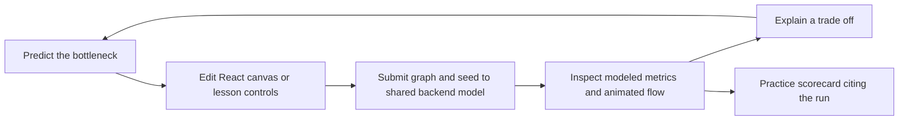

# ArchArena

Learn system design by changing an architecture, running a model, and explaining what happened.

ArchArena is a local portfolio application for Java backend developers preparing for system design interviews. Learn is a read-only reference library; Practice is the editable graph/worksheet playground backed by a bounded Java simulation engine. Design Studio is now an unlocked workspace for six design artifacts.

**Current:** Bounded engine v2 on Java 21 / Boot 4.0.9, sampled replay, forty original HLD/LLD readings, twenty company-inspired reference studies, five concept experiments in Practice, local Studio bundle export and a 72-second captioned introduction video. The reference edition is editorial-review-pending; company proposals are not verified internal architectures. AI and domain-correctness grading remain unimplemented. Public deployment is **not ready**: see the [original-prompt phase audit](docs/PHASE-AUDIT.md), [twenty security checks](docs/security-review.md), [current status](docs/STATUS.md) and [latest verification](docs/evidence/library-studio-verification.md). Earlier reports remain historical evidence.

## Your agreed direction

- Frontend: React with TypeScript, Vite, React Flow and Recharts are implemented locally.
- Backend direction: Java 21, Spring Boot 4 modular monolith, separate bounded simulation worker, PostgreSQL with Flyway.
- Work budget: interpreted as **9 hours per week**. Confirm this interpretation if “9” meant weeks.
- Launch horizon: **24 weeks, 216 hours**, a planning assumption rather than a deadline you supplied. Includes 27 hours of contingency; the complete original product is substantially larger.
- Audience: Java developers preparing for system design interviews.
- Release: personal portfolio demo, Learn plus basic Practice. No public registrations.
- AWS: account created after July 15, 2025. Exact creation date, current plan, remaining credits and expiry are unknown. Existing account eligibility does not restart when this project deploys.
- Target new cloud spend: $0/month. Local operation is the default and remains the launch fallback.

## Read the Phase 0 deliverables

1. [Product requirements and acceptance criteria](docs/phase-0/product-requirements.md)
2. [Capacity assumptions and cost comparison](docs/phase-0/capacity-and-cost.md)
3. [Competitor evidence and honest positioning](docs/phase-0/competitors.md)
4. [Week-by-week delivery plan](docs/phase-0/roadmap.md)
5. [Architecture decision records](docs/adr/phase-0-decisions.md)
6. [Risks and evidence register](ISSUES.md)
7. [Verification, exit checklist and interview answers](docs/phase-0/review.md)

Machine-readable planning inputs live in [planning.json](docs/phase-0/planning.json). Validate their arithmetic and document references using Python 3:

```powershell
python scripts/validate_phase0.py
```

This validates the Phase 0 plan only. Current Windows prototype commands are in [howtorun.md](howtorun.md). Compose/PostgreSQL and remote CI remain unverified. No AWS resources were created; AI is disabled.

## Product loop



The diagram is a product concept, not the Phase 1 technical architecture. Simulated latency and throughput describe explicit assumptions; they are not measurements of a real deployed architecture.

## Current project documents

- [Problem discussion](problemstatement.md), [HLD](hld.md), [LLD](lld.md), [interview questions](interviewquestions.md), [issues](ISSUES.md).
- [UI audit](docs/ui/repo-audit.md), [design brief and alternatives](docs/ui/design-brief.md).
- [Unpublished knowledge pack](docs/knowledge/README.md) and [content policy](docs/knowledge/content-policy.md). No supplied books are website assets.
- [Detailed session log](docs/session-log.md) distinguishes implementation, tests, assumptions and unresolved work.

Latest protocol: one approved step at a time. The user chose B — Expedition Console. Wait for `next` before Step 3; unfinished tracks are not launch-ready.
