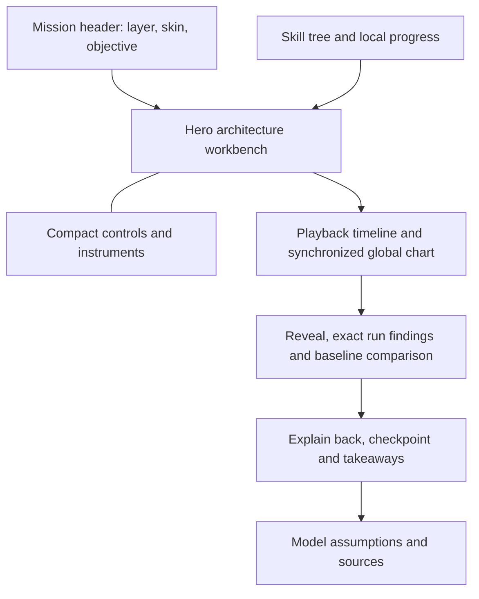

# ArchArena UI redesign Step 1 design brief

Status: Step 1 proposal retained for history. The user subsequently chose **B — Expedition Console**. Step 2 uses warm charcoal, teal/amber, self-hosted Sora and IBM Plex Mono. The old Signal Deck token table below is not the selected implementation. See [Step 2 foundations](step-02-foundations.md) and [repo-audit.md](repo-audit.md); backend/API stay frozen.

## Goal in plain language

Make the architecture the place where learning happens. A learner chooses what might break, changes one control and sees a clearly labeled model respond. Explanation and feedback stay near the graph instead of pushing it off screen. A child can use Story wording; a Java developer can switch to Pro detail without changing the simulation.

Technically, keep React Flow for editing and put illustrative request motion on a separate Canvas2D overlay. React owns meaningful state changes; a bounded animation loop owns paint frames. Only show metrics the existing API actually returns. Node statistics are whole-run aggregates; global time samples can be scrubbed.

## Two visual directions

| | A — Signal Deck, recommended | B — Expedition Console |
|---|---|---|
| Palette | Near-black navy, cyan traffic, mint healthy, amber strain, red failure | Charcoal with slightly warmer surfaces, teal traffic and warm white typography; same semantic status colors |
| Type mood | Space Grotesk display/body, IBM Plex Mono for numbers; self-hosted | Sora display/body, IBM Plex Mono for numbers; self-hosted |
| Signature element | Central flight-deck architecture with a compact right-side instrument rail and a timeline under the graph | A navigable expedition map of lesson islands surrounding an experiment board; mission notebook beneath |
| Strength | Makes request routing and failures easiest to inspect; strongest fit for the existing product | More approachable for younger learners and extended narrative lessons |
| Trade-off | Can feel too technical unless Story layer reduces labels and help is explicit | Narrative/map decoration can compete with the architecture and uses more screen space |
| At 10x | Dense graphs require level-of-detail and a node search; avoid adding permanent panels | Map layout and navigation need virtualization; avoid decorative DOM growth |

**Recommendation: A — Signal Deck.** It directly fixes the small-graph problem. Friendliness comes from Story/Simple wording, clear objectives and a skippable guide, not from adding ornament. B remains a real alternative; do not implement A before the user chooses.

## Design principles

1. The architecture is the hero at every viewport. Controls may collapse; the experiment must remain visible.
2. A model's uncertainty is part of its explanation. Persistent label: **Modeled, not measured**. Analytic mode adds **Approximate estimate**; cost adds **Illustrative weights, not an AWS quote**.
3. Every status uses a word/icon/pattern as well as color: healthy/check, strain/warning triangle, saturated/hatched warning, failed/cross, unknown/dashed outline.
4. Minimum 14px informative text, 16px body, 44px interactive targets where feasible, visible focus and AA contrast verified by automated token checks.
5. Motion explains direction and relative load. It does not pretend to be a request trace or hide critical information.
6. Story, Simple and Pro layers share facts. Story/Pro skins change labels and original SVG iconography only, never the graph or engine parameters.
7. Preserve all existing actions, including on mobile. A redesigned screen that loses export or saved designs is a regression.

## Proposed tokens for direction A

Implement later in one file, `frontend/src/styles/tokens.css`. The table is a proposal, not proof of contrast. Verify actual foreground/background pairings before merging any theme.

| Token | Proposed value | Use / restriction |
|---|---|---|
| `--color-bg` | `#06080F` | Page background |
| `--color-panel` | `#0D1220` | Main surfaces |
| `--color-panel-raised` | `#151E30` | Inspector, command palette |
| `--color-text` | `#E6ECFF` | Primary text |
| `--color-text-muted` | `#ABB8D1` | Secondary informative text, never faint decoration for required content |
| `--color-traffic` | `#2DE2E6` | Traffic and active timeline |
| `--color-healthy` | `#3DF5A7` | Healthy plus check icon |
| `--color-strain` | `#FFB020` | Strain plus warning icon/pattern |
| `--color-failure` | `#FF4D6A` | Failure plus cross and text |
| `--color-line` | `#62718F` | Interactive/meaningful boundaries; check ≥3:1 on adjacent surface |
| `--color-focus` | `#DCEB69` | Focus outline, distinct from selection |
| `--color-on-accent` | `#06080F` | Text on bright filled buttons; never white-on-cyan without testing |
| Type | 14, 16, 20, 28, 40px | 14 minimum for help/control labels; 16 body; numbers use tabular figures |
| Display/body font | Space Grotesk variable WOFF2 | Self-host; check exact package license and retain license text |
| Number font | IBM Plex Mono WOFF2 | Self-host; verify license and serve only required weights |
| Spacing | 4, 8, 12, 16, 24, 32, 48px | Consistent control/panel rhythm |
| Radius | 4px controls, 8px panels | No pill/rounded-card overload |
| Motion | 120ms focus/state, 200ms panel, ≤300ms reveal | No screen shake; zero nonessential transition under reduced motion |
| Z layers | 0 background, 10 particles, 20 graph nodes, 30 controls, 50 inspector, 80 modal, 90 palette, 100 announcements | Particle canvas must not intercept pointer/keyboard input |

Validate fonts against official font repositories or the selected npm package's bundled license at implementation. No font fetches/CDNs at runtime. A neutral local fallback is acceptable while a font loads; the intended design must actually self-host the chosen fonts.

## Screen hierarchy

Desktop 1440px: narrow skill-tree rail, ≥60% available content width for the graph, controls/instruments in a right rail. Canvas height target 440–560px, with playback immediately beneath. At 1024px: collapse the navigation rail to a labeled drawer, keep canvas dominant, place instruments below. At 768px: graph above instruments/controls; lesson map and notes use accessible disclosure panels. At 390px: single column, visible lesson and saved-design buttons, canvas first, horizontally scrollable time plot with an equivalent textual sample readout. No whole-page horizontal overflow or hover-only action.

## Component inventory

| Component | Responsibility | State/test boundary |
|---|---|---|
| `WorkbenchShell` | Navigation, responsive layout, mode and shortcuts | Integration tests preserve access to all existing features |
| `MissionBriefing` | Original scenario, objectives and skippable help | Only approved knowledge feeds published mission text |
| `LayerSkinSwitch` | Story/Simple/Pro and Story/Pro visuals | Switching must not change request JSON or seed |
| `ArchitectureWorkbench` | React Flow nodes/edges and selection | Preserve editing, validation, undo/redo and draft conflict behavior |
| `TrafficOverlay` | Separate Canvas2D illustrative flow | No per-frame React updates; bounded particle count; static alternative |
| `NodeInspector` | Node configuration and aggregate statistics in plain words | Keyboard-accessible equivalent via searchable node list |
| `RunControls` | Traffic, profile, failure, seed, run status | Match existing limits and error handling |
| `MetricInstrument` | Modeled metrics, exact values, supported deltas | Formatting, labels, baseline compatibility and null states |
| `PlaybackController` | Play, pause, speed, cursor and accessible sample readout | Pure reducer tests; no API calls while scrubbing |
| `PredictionReveal` | Locked node guess, outcome evidence and local practice feedback | Freeze guess per run, allow inconclusive outcome |
| `SkillTree` | Lessons, selected/completed state and progress | Keep all existing lessons accessible; no new hard progression lock without domain approval |
| `CheckpointObjectives` | Existing server checkpoint plus explain-back reflection | Backend completion remains authoritative; local XP cannot unlock server mastery |
| `RulesPanel` | Actual result findings with metric references | Do not invent moment-specific rule results |
| `CommandPalette` | Ctrl/Cmd+K navigation/actions, search and cheat sheet | Escape close, focus trap/restore, no shortcut hijacking in editors |
| `SavedDesignDialog` | Preserve save/open/delete and conflicts | Dialog keyboard tests and empty/error states |
| `AssumptionsDisclosure` | Model scope, approximate values and source/provenance | Disclosure always reachable; essential label remains outside collapsed panel |

Names are proposed module boundaries, not library APIs or code already present.

## Interaction specifications

### Mission, predict, run, reveal

The briefing names one objective and asks which node is most likely to constrain the run. The learner selects a node on canvas or through a keyboard list, optionally selects “no bottleneck expected,” writes a short reason and locks the guess. A run records the UI-only prediction alongside the returned run ID and immutable request context. Once accepted, edits cannot silently change that run's guess. A changed graph is a new experiment.

After completion, compare the guess with a clearly disclosed **UI-derived hypothesis** using the returned maximum queue depth, dropped count and aggregate utilization. A tie or insufficient evidence produces “inconclusive,” not a fabricated correct answer. Show exact supporting fields and allow the learner to explain disagreement.

XP at this UI-only stage is a **local practice bonus**, stored on this device, once per unique run ID. It is not server-verified, secure against tampering, a public rank or a mastery score. The existing backend checkpoint is the only source of lesson completion. Server-trusted prediction scoring/XP requires a separately approved backend/domain change; do not add it here. Proposed local award values are product assumptions to choose in Step 5, not researched facts or existing behavior.

### Time scrubber and synchronized chart

Playback cursor ranges over returned timeline samples. Controls: play/pause, 1×/4×/8×, Home/End and arrow-key sample movement with visible shortcut help. Dragging pauses; releasing retains that point until play resumes. Changing speed changes playback only, not model time or results. End of playback pauses without submitting another run.

At a selected sample, global successful req/s, combined unsuccessful-outcome ratio and queue depth update from that sample. Mark them **modeled sample at t**. Keep whole-run p95, node utilization and whole-run rules fixed and labeled **whole run**. The chart cursor aligns with the chosen sample; gaps are unknown, not interpolated measurements. Interpolated particle motion is decorative and separately labeled.

No API change is required for this limited, honest playback. Exact time-specific node gauges, per-edge routing, policy/error separation per sample and moment-specific rules need additional backend telemetry. If those become mandatory, stop before implementation and request the API change; never synthesize “real” telemetry in the UI.

### Living diagram and node inspector

Render arrows and node states statically first. Add a pointer-transparent canvas overlay after states and labels are tested. A single requestAnimationFrame loop reads a bounded model from refs, not React state. Build/refresh edge paths on layout/zoom changes; never query every node's DOM on every frame. Density uses global modeled throughput with a disclosed uniform routing approximation, capped by quality setting. Canvas particles are not individual requests.

Per-node glow and a maximum-queue tank use aggregate statistics and are labeled **whole-run utilization** / **largest modeled queue**, never momentary values. A global queue meter may use timeline samples. Failure/drop effects can only be aggregate-rate illustrations: no invented failure location or exact dropped-request timestamp. Click or keyboard-select opens an inspector with node label, aggregate demand/capacity wording, queue maximum and available evidence. Explain missing data rather than showing zeros.

Proposed quality settings: Off (static), Low (≤150 illustrative particles, 30 fps target), Standard (≤500, 60 fps target). Caps are design budgets, not measured results. Pause offscreen/hidden tabs; respect reduced motion automatically; the user can opt for static even without a system preference. Do not add PixiJS/WebGL unless Canvas2D profiling shows a concrete need.

### Instruments, baseline and budget

Arrival demand and successful throughput are different: label the current analytic number “modeled arrival demand”; only an event result can show its modeled successful throughput. Humanized latency retains exact value in accessible text/details, not only a hover tooltip. Analytic p95 is explicitly approximate. Avoid a universal “unusable” threshold: compare latency to an explicitly assumed lesson target instead.

Pin a result with full traffic/profile/seed/duration/engine/assumptions context in UI state. Compute comparable deltas only with matched contexts; explain mismatches. A cost bar compares illustrative node weights with a user-entered illustrative budget, not an AWS bill or free-tier balance. Color cannot imply a guarantee of real-world capacity or price.

### Navigation and game layer

The skill tree connects the five existing lessons in teaching order but preserves direct access. Completed comes from the backend. Only unavailable future lessons/Studio are locked. Skill-tree visual links have an accessible ordered-list equivalent.

Mission alerts name the active failure input and disclose its simplification. Do not call it an AZ outage or real service crash. Local achievement toasts are skippable, nonblocking and announced once. Guide name remains an open user choice; no mascot generation or new dependency at this gate.

Command palette opens with Ctrl/Cmd+K, supports arrows/Enter/Escape and restores prior focus. Actions include lessons, Learn/Practice, saved designs, assumptions, run when valid, playback and help. Unavailable actions expose a reason. Disable shortcuts inside text fields/graph editors unless the combination is reserved and documented. A visible button provides the same feature on touch devices.

## What will be removed or replaced after approval

- Cream/sage theme, repeated white metric cards and slogan/filler copy.
- 6–11px informative labels, low-contrast text and decorative all-caps overuse.
- Unicode/emoji-like interface icons; replace with original lightweight SVGs, with accessible names where needed.
- Mobile CSS that hides lesson/saved-design access without an alternative.
- Permanent sidebar width that compresses the graph at medium sizes.
- Unqualified percentage-only utilization labels and misleading whole-run values that appear time-local.
- The generic external GitHub link, excessive empty canvas framing and a modal without proven focus management.

Keep every existing functional action. Do not remove the assumptions panel, model labels, export, baseline, checkpoint, graph editing or error states.

## Test and evidence plan for Steps 2–9

1. Before UI code: patch the current Vite advisory with a verified compatible version; add Vitest, React Testing Library and axe only after checking exact versions/licenses. These are test dependencies, not new animation frameworks. Explain added bundle cost, if any.
2. Unit-test wording, exact-value preservation, illustrative cost labels, state/particle mappings and scrubber reducer. Prediction feedback tests include ties, no bottleneck, missing metrics and duplicate run IDs.
3. Component-test instruments, rules, lesson states, layer/skin switching, prediction lock, objectives and palette focus. Assert persistent **Modeled, not measured** text across loading/error/empty states.
4. Add token pairing tests calculating WCAG relative luminance/contrast for every used pair. Text ≥4.5:1; large text/UI graphics ≥3:1. Test focus/border/disabled states and all semantic signals on actual surfaces.
5. E2E: mouse and keyboard complete one lesson through export; all five lessons load; saved designs open; out-of-order previews, API failure/slow response and empty results show explicit states. Keep real-backend smoke tests separate from deterministic mocked presentation fixtures.
6. Axe on Learn/Practice/locked Studio, modal/palette and saturated/failed/loading/error states. Check aria-live summaries, reduced-motion static replacements, no color-only status and manual keyboard navigation.
7. Snapshot 1440/1024/768/390px with fixed seed, locale, time, cursor, fonts and animations disabled. Capture 1440/390 evidence after each implementation step, critique and fix. Document when capture cannot run rather than marking it passed.
8. A synthetic 300-node fixture tests renderer/overlay only, never backend admission. Report machine/browser, warm-up, graph/edge count, quality, p95 frame time and long frames. 60 fps target means about 16.7ms/frame; report misses and offer lower quality. Measure production-build bundle and Lighthouse separately.
9. Proposed budgets to validate after baseline: initial-route JS ≤350 kB gzip; total JS ≤500 kB gzip; Lighthouse performance ≥90/accessibility ≥95. These budgets do not prove WCAG or 60 fps, and may require lazy-loaded charts/canvas.

No runtime UI behavior is verified by this document. Existing frontend suite currently contains zero tests. CI configuration exists but has not run on a connected repository.

## Risks and proof

UI risks and content provenance are tracked in ISSUES.md as UI01–UI08 and C01–C03. Required proof includes tests, screenshots and measurements; a proposed token or interaction alone does not close a risk. The backend/API freeze manifest will detect accidental changes during this track.

## Step 1 exit checklist

- [x] Current code, dependencies and test gaps audited.
- [x] Two directions compared and one recommended.
- [x] Tokens, components, responsive hierarchy and interactions specified.
- [x] Data honesty, backend freeze and 300-node UI-only limit explicit.
- [x] Content review and future test gates documented.
- [x] User selected B — Expedition Console; Step 2 foundations are the approved implementation scope.

What could go wrong: decorative motion misrepresents missing telemetry, local XP looks authoritative, or small labels return as density increases. Verify with mapping tests, explicit qualifiers, contrast/readability checks, screenshots and manual keyboard review.

Three interview answers: Canvas2D avoids per-frame React renders; global samples do not establish per-node historical behavior; frontend-only XP cannot be a trustworthy anti-cheat score. Further questions live in interviewquestions.md.
