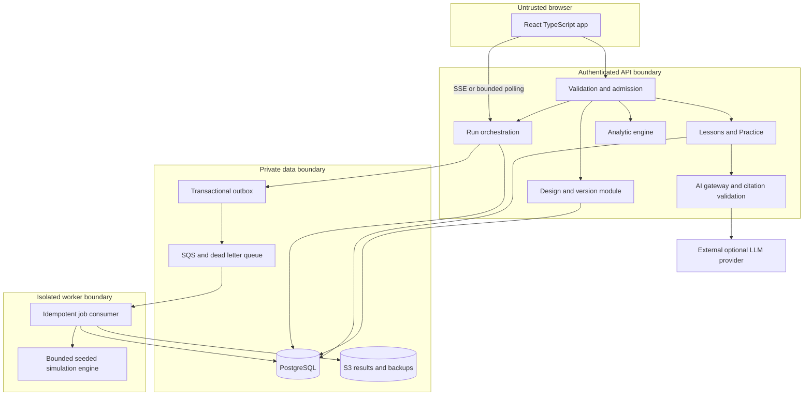
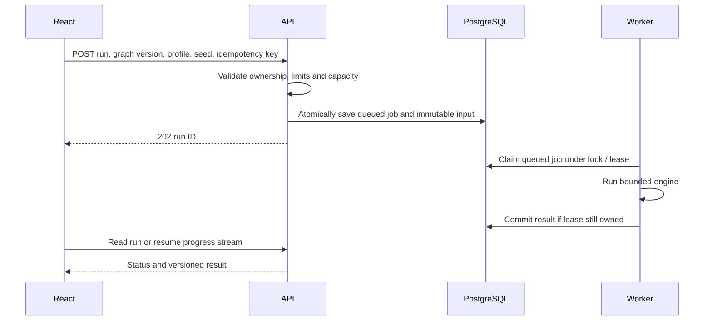
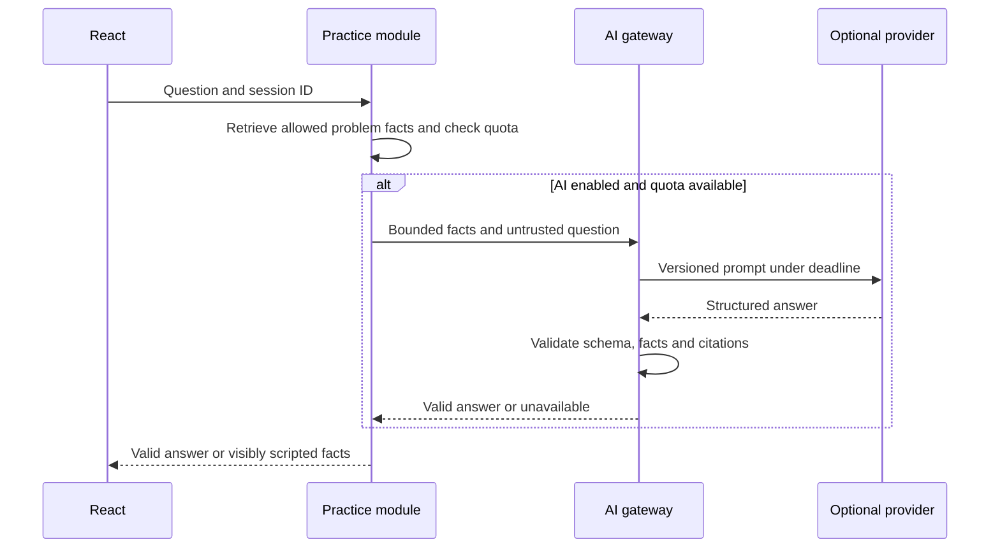
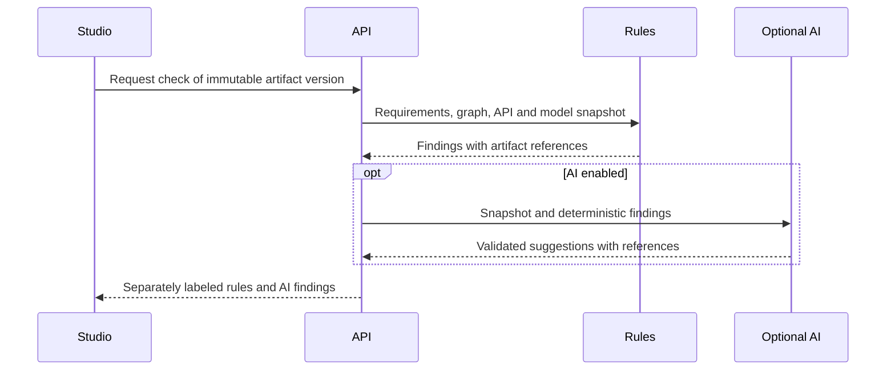
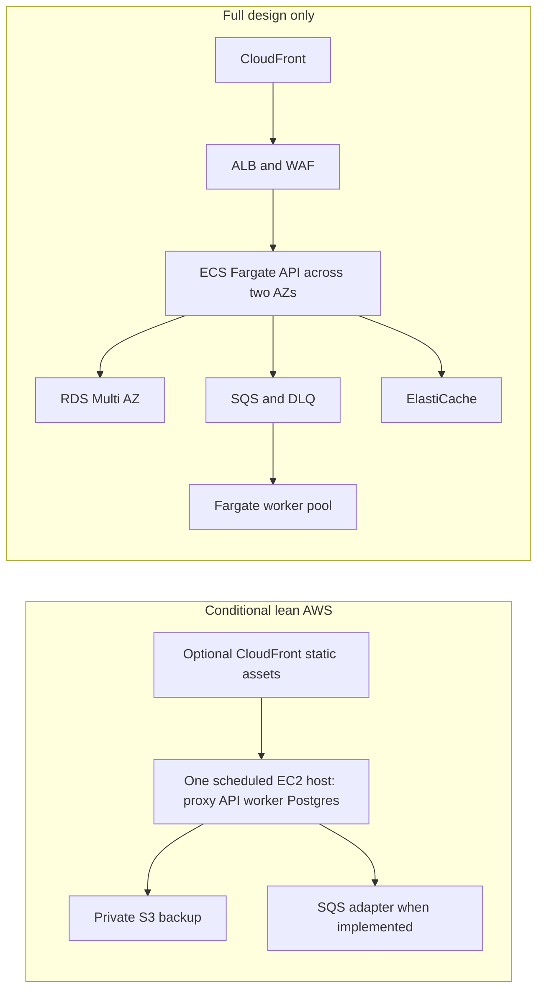

# ArchArena high level design

Status: Phase 1 design. Implementation evidence and deviations are recorded in ISSUES.md. Phase 0 constraints remain: owner-operated portfolio demo, React frontend, Java 21/Spring Boot backend, $0 new spend target, local operation first.

## Plain language

The browser is a workbench. It edits a design but cannot award itself a score. The API validates and saves the design, provides quick estimates and accepts longer experiments. A worker performs those experiments within strict limits. A database remembers the inputs and outputs. Optional AI explains validated results; its absence must not prevent learning.

One application contains feature modules rather than many tiny services. The worker is separate because a simulation that uses too much CPU or memory must not take down the API.

## Logical architecture and trust boundaries



The diagram describes the target transport adapters. The initial local implementation may use a PostgreSQL job queue with `FOR UPDATE SKIP LOCKED` instead of SQS; record that as an explicit adapter deviation, not implemented AWS messaging. For a single-node demo this avoids a second source of job truth. SQS requires an outbox and idempotent consumer, not a transaction across PostgreSQL and AWS.

### Responsibilities and deployables

| Module | Responsibility | Allowed dependencies |
|---|---|---|
| Identity/access | Determine owner, reject unauthorized calls, assign correlation ID | Configuration and identity adapter |
| Design | Validate immutable graph snapshots and versions | Repository and graph domain |
| Run | Admission, idempotency, job lifecycle, result lookup | Repository, engine interface, queue adapter |
| Engine library | Validate and model graphs, produce deterministic results | Java standard library; no HTTP or database |
| Learning | Lesson content, prediction and checkpoint evaluation | Run results and progress repository |
| Practice | Problem facts, estimates and scorecard | Run results and optional AI gateway |
| AI gateway | Deadline, quotas, schema and citation verification | Provider interface; never direct browser credentials |
| Consistency, later | Cross-artifact rules, then AI suggestions | Versioned Studio artifact snapshot |

Deployables: static React build, API JVM and worker JVM. Share engine/domain classes in the same repository; do not create an engine HTTP microservice. PostgreSQL is infrastructure. Redis is optional, not a prerequisite. Package boundaries are finalized in LLD.

## Four sequences

### Run an experiment



Duplicate keys with the same canonical request return the prior run; changed payload is 409. Failure is terminal and explicit. A process crash is recovered through lease expiry and bounded attempts, never by allowing stale workers to overwrite newer attempts.

### Interview clarification and optional AI



### Learn control changes

```mermaid
sequenceDiagram
 participant UI as React
 participant API
 participant E as Analytic engine
 UI->>UI: Mark old result stale and debounce 400ms
 UI->>API: Latest graph snapshot and revision
 API->>API: Validate and enforce preview quota
 API->>E: Bounded analytic estimate
 E-->>API: Estimates and assumptions
 API-->>UI: Estimate with matching revision
 UI->>UI: Ignore superseded revision; update metrics
```

### Studio consistency, deferred



This sequence is a design contract, not an implemented Studio endpoint.

## Sync and async boundaries

Synchronous: content reads, graph validation, bounded analytic estimates, design saves and job admission. Asynchronous: event simulations, optional AI, backups and heavy exports. Return 202 for jobs; no long-held database transaction across simulation or provider calls. SSE is a notification channel, not durable job storage. A polling adapter can be the initial implementation; do not advertise SSE until reconnect and event IDs are tested.

## Deployment mapping



Lean is one failure domain with scheduled downtime. Full has private tasks, explicit egress routes/endpoints, managed database and queue-depth scaling; ECS is preferred over EKS because the product does not require Kubernetes features and EKS adds control-plane cost/operations. Neither diagram authorizes cloud creation. Check current Free-plan access and rates for every service against the existing account; details and sources are in the Phase 0 cost worksheet. No $0 guarantee.

## Failure behavior

| Component | Failure | Exact user-visible behavior | Recovery contract |
|---|---|---|---|
| PostgreSQL | Unavailable or full | Saved operations fail with 503; UI retains unsaved draft and offers retry. No false saved/success state | Readiness fails; restore DB; idempotency permits safe retry |
| Redis, optional | Unavailable | Bypass cache; show fresh results more slowly; reject admission if the quota authority cannot be checked | Never bypass security quotas merely because a cache is down |
| SQS, future | Unavailable | Accepted job stays queued with delayed status; no missing job | Outbox retries; DLQ surfaces terminal diagnostic after bounded attempts |
| S3, future | Upload/download fails | Run remains incomplete or export unavailable; previous committed summary stays readable | Retry without committing a result referencing a missing object |
| Worker | Crash/timeout | Queued/running status followed by retried or timed-out state; last design remains editable | Lease expiry, bounded attempt count, stale-owner fencing |
| LLM | Timeout/quota/invalid output | Banner “AI feedback unavailable”; deterministic findings still shown | No paid fallback; short deadline and circuit breaker before public AI |
| Browser/network | Refresh, disconnect, two tabs | Draft recovery and run reload; conflicts shown instead of silent overwrite | Version preconditions; reconnect with cursor for SSE or resume polling |
| Entire lean host | Stops or fails | Demo unavailable; recording/local run instructions remain alternative | Restore drill and documented demo windows |

## Architectural decisions

ADR 008: compare SQS/outbox versus PostgreSQL job queue versus an in-process executor. Choose a database queue for the first runnable local slice, because job persistence and admission can commit atomically with fewer moving parts. In-process queues lose jobs on restart. SQS/outbox is the planned cloud adapter, not assumed complete. At 10x, queue polling and DB contention need measurement; migrate behind the transport interface before fan-out grows.

ADR 009: compare SSE versus polling versus WebSockets. Initial bounded polling is easiest to verify and survives refresh without stream infrastructure. SSE is the target for one-way progress; WebSockets are unnecessary until bidirectional collaboration exists. At 10x, polling/read load or SSE connection count needs explicit budgets. UI must stop polling terminal jobs and cancel timers on unmount.

ADR 010: compare an external free LLM, a local GPU model and deterministic feedback. Choose deterministic first with an optional gateway; no GPU dependency or paid service. At 10x, tokens and provider quotas dominate. Do not defer validation/quotas merely because a provider advertises free access.

## Phase 1 verification and exit

Review the four sequences, ownership boundary, module dependencies, lean/full differences and every failure row. Cross-check job limits with Phase 0. No performance or failover is proven by these diagrams. Exit: proceed to LLD using explicit adapter deviations, carrying runtime risks into ISSUES.md.

Interview answers: the worker isolates expensive work; the database is the authoritative lifecycle store; optional AI failure must not invalidate deterministic simulation results. More detailed questions are maintained in interviewquestions.md.

## System-design learning and practice views (November 19)

The frontend now separates HLD and LLD artifacts while retaining the existing backend contracts. `system-design/catalog.ts` supplies 24 HLD and 16 LLD original exercise briefs plus twenty scenario briefs. `LearningRoute` renders a route/index and either a system-map sequence or Java blueprint. `PracticeGuide` renders scenario-specific requirements, eight structured worksheet fields and a rule-based coach. In both LLD Learn and LLD Practice the generic simulator/results are hidden; worksheet and graph remain separate artifacts.

The coach receives a graph and only a result matching the current canonical experiment. Missing prose is actionable; supplied prose and business invariants remain manual-review status. Graph constraints mirror only a subset of simulator restrictions, and backend validation remains authoritative. Scenario changes clear result context; the server job itself is not canceled. Worksheets persist in browser-local storage by scenario, not backend saves/exports. See [learning/practice scope](docs/learning-practice.md) and [ADR UI-003](docs/adr/ui-003-system-design-tracks.md).

## Engine v2 and public-readiness update

The bounded virtual engine now supports nine component types, bounded retry attempts/deadlines, dependency holding/cascading pressure, circuit breakers, delayed service scale-out, synthetic shared-record lag/fresh reads and sampled node telemetry. Results travel through the same persisted DB queue and separate worker. The runtime is now Java 21 / Spring Boot 4.0.9 after dependency remediation; historical Boot 3 diagrams/plans remain planning history. Persistence is still JDBC, not JPA/Hibernate.

See [simulation scope](docs/simulation-v2.md), [engine decision](docs/adr/engine-002-bounded-resilience.md), [runtime migration](docs/adr/security-001-runtime-upgrade.md) and [twenty security checks](docs/security-review.md). A single local owner/proxy token is not public multi-user authentication. No cloud or public deployment is claimed.


## Latest read-only library and unlocked Studio (November 19)

This supersedes the earlier LearningRoute/locked-Studio description. LearnLibrary serves original, read-only HLD/LLD/company references and an introduction video. It does not render the editable graph or issue analytic-preview POSTs. Practice is the sole simulator playground; five concept experiments retain prediction/checkpoint behavior alongside company worksheets. Company reference pages navigate into an editable minimal starter, not a pre-solved system.

DesignStudio is an unlocked six-artifact authoring workspace with browser-local storage and JSON export. It explicitly captures a detached snapshot of the current Practice graph; it does not synchronize later graph edits or implement semantic consistency validation. The capacity calculator is an assumption worksheet, not simulator traffic configuration. Learn/Studio remain usable without the API; backend operations in Practice require the API and separate worker.

See [phase audit](docs/PHASE-AUDIT.md), [reference provenance](docs/knowledge/local-reference-edition.md) and [current verification](docs/evidence/library-studio-verification.md). Public identity/isolation, session/CSRF, PostgreSQL RLS and deployment gates remain open.
