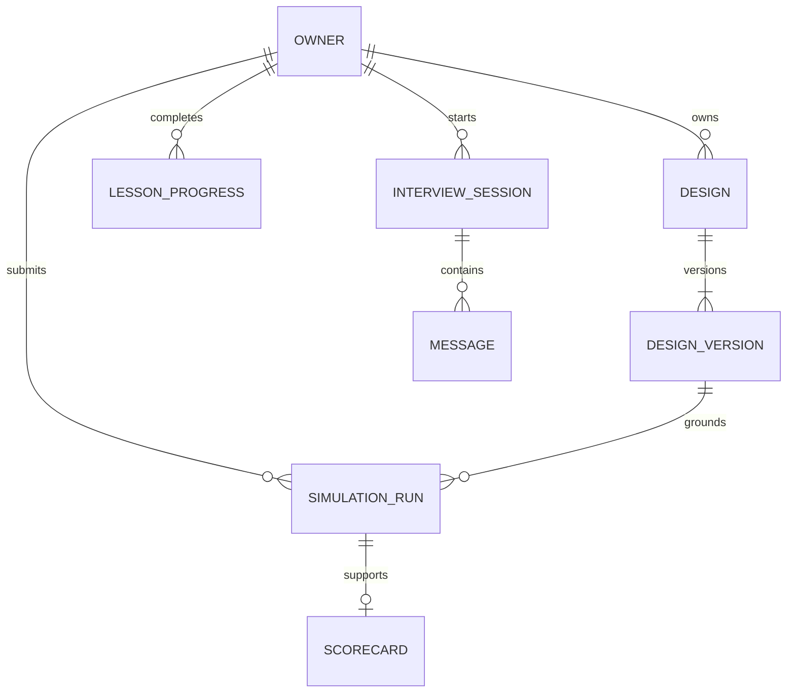
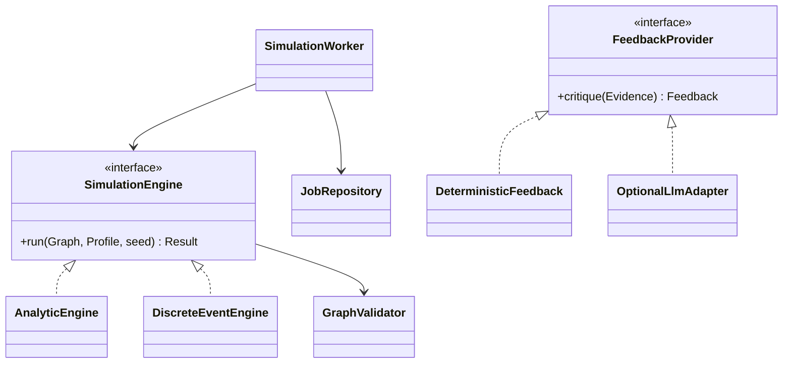
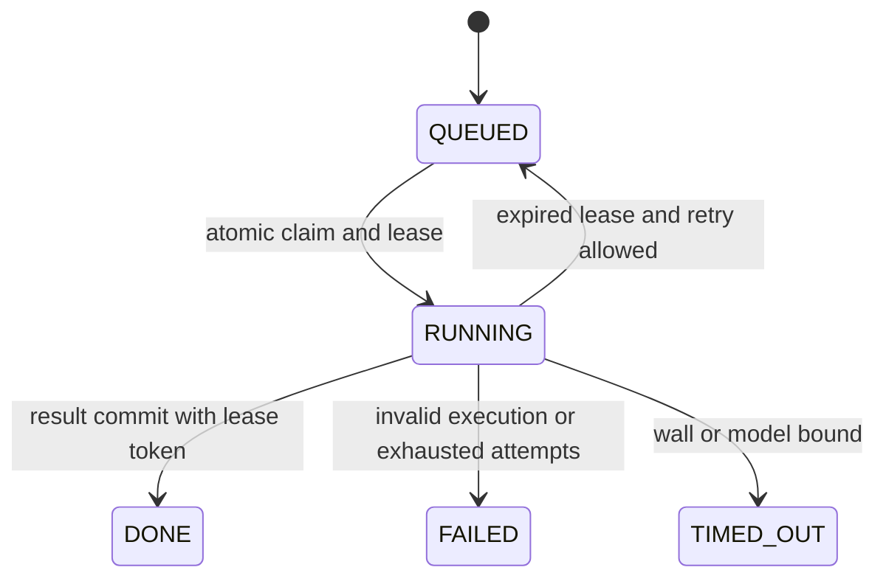

# ArchArena low level design

Status: Phase 2 design contract. Implemented subsets and tests are tracked in ISSUES.md. A single Maven project may package API and worker entry points while sharing a dependency-free engine; process isolation does not require a separate repository.

## Domain and ownership

`Owner -> Design -> immutable DesignVersion -> SimulationRun -> Result -> Scorecard`. A run stores an immutable graph snapshot, profile, seed, engine version and assumptions version. Never compute provenance from the latest mutable design. Owner is derived server-side, never trusted from request JSON.

Deferred Studio entities: Requirement, ApiSpec, DataModel, DesignDocument, ADR and artifact references, all associated with an immutable DesignVersion. Deferred gamification: XP ledger with unique event key, Badge and award, with server-owned scoring. Problems/Lessons begin as validated versioned content, not editable runtime code.

## Package responsibilities

`dev.archarena.engine`: graph records, validation, analytic/event strategies and result models.

`dev.archarena.api`: HTTP records/controllers, validation/error responses and access filter.

`dev.archarena.persistence`: owner-scoped SQL, migrations, atomic admission and leased job claims.

`dev.archarena.worker`: worker polling, bounded process work and lifecycle transitions.

`dev.archarena.learning`: versioned lessons, assumptions and deterministic checkpoint findings.

`dev.archarena.practice`: problem facts, estimation and rubric. `dev.archarena.ai`: optional provider port; disabled is a supported implementation.

## Graph contract and model boundary

Graph has nodes and directed edges. Node IDs are unique, labels bounded, types enumerated, parameters finite and within documented ranges. Graph JSON ≤64 KiB, ≤30 nodes, ≤60 edges. Require one client entry point, reachable nodes, an acyclic request path and legal cache miss/DB relationships. Reject rather than guess unsupported topology. Queue worker count and service replicas are node parameters. Labels are data, never executable instructions or HTML.

Simulation accepts virtual duration ≤120 seconds, ≤10,000 arrivals and ≤200,000 processed events. A worker wall deadline and external memory/CPU limits are independent controls. Engine input seed has an explicit numeric range that JavaScript can represent safely. Engine/assumption versions are persisted; changing sampling or metric definitions requires a version bump.

## Job state and concurrency

Submission transaction locks a single admission row before counting queued/running work, ensuring two API requests cannot both over-admit. Scope an idempotency key to owner plus endpoint, store canonical request hash, and return 409 for key reuse with a different request. Payload canonicalization includes graph, seed, engine/profile versions and sorted graph IDs. Cache result hash also includes owner unless sharing is explicitly authorized.

Claim with `FOR UPDATE SKIP LOCKED`, assign a random lease token and timestamp. Complete only `WHERE id=? AND lease_token=? AND status='RUNNING'`. A stale worker cannot overwrite a retried run. Retry at most twice for crash/transport errors, not deterministic validation failures. Distributed SQS delivery later adds outbox rows, idempotent consume and DLQ; none is replaced by claiming “exactly once.”

## Data model and indexes

Core migration belongs in `backend/src/main/resources/db/migration`. PostgreSQL tables: designs (UUID, owner, title, version, graph JSONB, created/updated timestamps); design_versions (design/version unique, immutable graph); simulation_runs (UUID, owner, graph JSONB, request hash, idempotency key, seed, status, attempt, lease token/expiry, result JSONB, error, timestamps); lesson_progress (owner/lesson unique, server-evaluated completion); interview_sessions/messages (owner and bounded text).

Owner + updated timestamp index serves design listing. Owner + run creation serves recent experiments. Partial queued status + creation index serves claim order. Running lease-expiry index serves crash recovery. Unique owner + idempotency key enforces retries. Unique design + version prevents duplicate snapshots. No speculative index on every JSON field; add only after an observed query and EXPLAIN plan. All repository reads/updates bind owner, including nested resources.

Optimistic locking uses a version precondition: a stale update returns 409 and both versions are preserved for user resolution. Initial hard deletion of designs preserves no public links; run/chat retention is bounded and deletes referenced object keys before final erasure completion once S3 is used. Backups have a documented expiry, so “delete” must not falsely imply instant removal from all backup media. Soft delete is not privacy erasure.

## API contract

Version routes under `/api`. Planned operations: health/readiness, lessons, problems, graph validation, analytic preview, run submission/read, design CRUD/versioning, deterministic scorecard, optional clarification and Markdown export. Graph/run owner never comes from JSON. Run submission returns 202 and Location; GET returns queued/running/terminal state. Errors use RFC 7807 fields (`type`, `title`, `status`, `detail`, `instance`) plus correlation ID, with no stack traces. Validation is 400; unauthenticated 401; conflict 409; quota/capacity 429; dependency failure 503.

The implementation's OpenAPI file must reflect actual routes, limits and response records rather than declaring deferred Studio routes operational. Auth for local owner mode uses loopback-bound services; hosted mode requires actual identity validation and must not reuse local bypass. Exact-origin CORS or a same-origin reverse proxy, token storage and CSRF strategy must be considered together.

## Patterns with a reason

Use Strategy for analytic/event engines and optional feedback providers. Use explicit node behavior dispatch before adding a Visitor hierarchy: seven node types do not justify layers of factories. Use an interview state machine only when multi-step progression exists. Immutable records plus validation construct graphs; a separate Builder is useful for test fixtures, not mandatory in runtime code. Command history powers browser undo/redo. Transactional outbox is justified when DB and SQS become separate durability boundaries.

## Phase 2 verification and exit

Validate migrations on real PostgreSQL, run owner-isolation/idempotency/conflict tests and align OpenAPI with controllers during implementation. The ER/class diagrams do not prove these properties. Exit from design means the data and lifecycle contracts are defined; runtime risks remain open until those checks run. Interview explanations and limitations are maintained in interviewquestions.md.

## Frontend design-artifact slice (November 19)

- `Topic`: id, HLD/LLD track, level, task, challenge question and optional existing lab id. Availability is explicit; no published theory flag is inferred.
- `Scenario`: id, company inspiration, mission, requirements, invariant, suggested operations and deep-dive prompt; these are original exercises, not company infrastructure facts.
- `Worksheet`: eight bounded strings keyed by scope, scale, api, data, invariant, failure, tradeoff and tests. Restore accepts only known scenario/field keys and string values, capped at 4,000 characters each.
- `ReviewItem`: stable id, missing/inspect/evidence state, plain text. `reviewDesign` is a pure function. It checks missing inputs, client/reachability/cycles/branching/terminal constraints, and quotes supplied current-run metrics. It does not grade Java, domain correctness or prose semantics.
- `PracticeGuide`: staged scenario selection, separate HLD/LLD sections, per-scenario local drafts, visible storage-failure fallback. Feedback recomputes against current graph/result on render. No HTML injection path or remote AI request.

Backend DTOs, persistence and grading endpoints are unchanged. Backend saved graph/version and Markdown export do not contain the worksheet. See [the implementation decision](docs/adr/ui-003-system-design-tracks.md).
